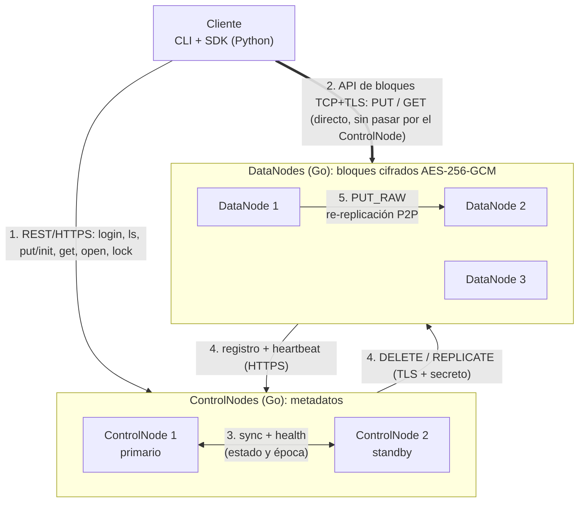
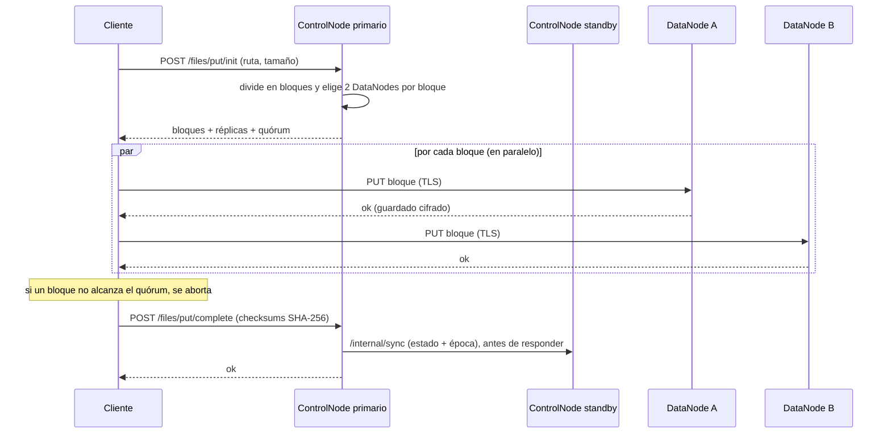
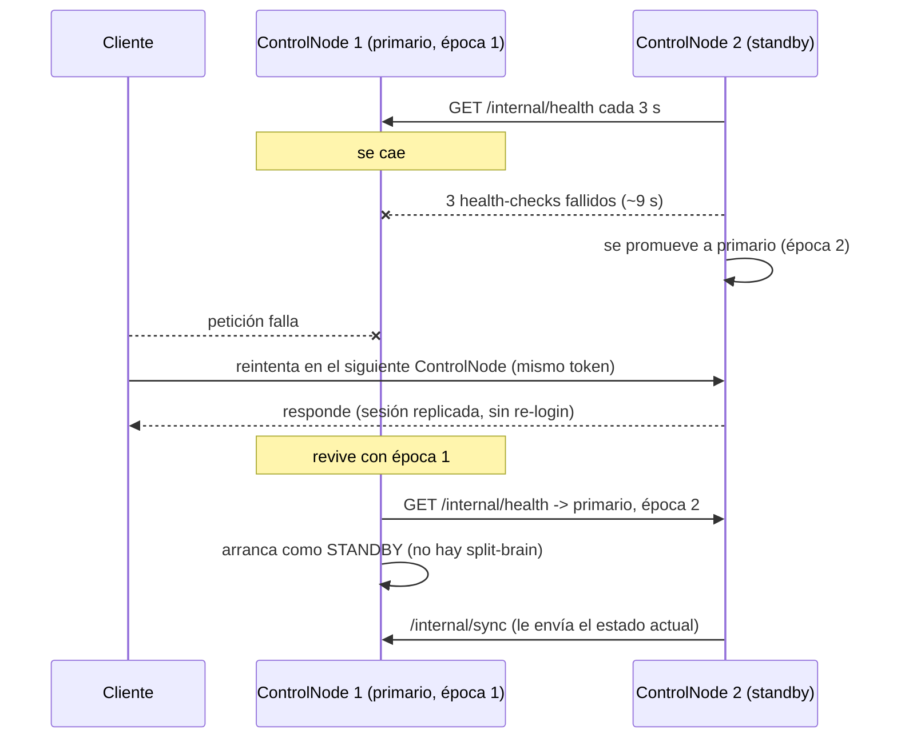

# DFSha — Sistema de Archivos Distribuido de Alta Disponibilidad

Proyecto 1 de ST0263 / SI3007 (2026-2). Sistema de archivos distribuido por
bloques con arquitectura **Cliente/Servidor (Maestro–Trabajador)**.

- **Servicio distribuido** (ControlNode + DataNode): **Go** (solo librería estándar)
- **Cliente**: **Python** (solo `requests`)

## Componentes

| Componente | Rol | Responsabilidad | API que expone |
|---|---|---|---|
| **Cliente** | CLI | Autenticación, `ls/cd/pwd/mkdir/rmdir/rm`, `put/get` con lectura y escritura directa a los DataNodes | — |
| **ControlNode** (x2) | Maestro | Metadatos, usuarios y sesiones, control de acceso, particionamiento y colocación, HA primario/standby, re-replicación | REST/JSON sobre HTTPS (puerto 5000) |
| **DataNode** (xN) | Trabajador | Almacena bloques cifrados, atiende lecturas y escrituras directas, copia bloques P2P | API de bloques TCP+TLS (`DN_PORT`) y REST HTTPS `/health` (`DN_API_PORT`) |

```
controlnode_go/   ControlNode (Go)
datanode_go/      DataNode (Go)
client/           Cliente CLI (cli.py) y SDK de acceso a archivos (dfsha.py)
common/           API de bloques del lado del cliente (blockproto.py)
proto/            Especificación formal de la API de bloques (protobuf)
gencert/          Generador del certificado TLS del clúster
docker/           Dockerfiles, docker-compose.yml (todo en una máquina)
docker/aws/       Compose de UN nodo por VM (AWS Academy / GCP)
docs/             Guía de despliegue en AWS
pruebas/          Pruebas end-to-end: prueba_local.sh (failover, caídas,
                  permisos), prueba_rf3.sh (open/read/write/lock) y
                  prueba_rebalanceo.sh
```

## Diagramas

**Arquitectura** (los 5 canales de comunicación; todos cifrados con TLS):



**Escritura de un archivo (`put`)**: el ControlNode solo decide dónde va
cada bloque; los bytes van directo del cliente a los DataNodes.



**Failover del ControlNode**:



## Cómo cumple cada requisito

| Requisito | Implementación |
|---|---|
| RF1 Gestión de archivos | `ls, cd, pwd, mkdir, rmdir, rm, put, get`. Rutas relativas al directorio actual |
| RF2 Transferencia (`send`/`receive`) | `put`/`get` (alias `send`/`receive`) mueven archivos completos. El ControlNode solo entrega la ubicación de los bloques; los bytes van Cliente ↔ DataNode y DataNode ↔ DataNode |
| RF3 Acceso (`open/read/write/lock/close`) | SDK `client/dfsha.py`, comandos `cat`/`write` y `shell` interactivo. Lectura parcial (solo los bloques del rango), escritura copy-on-write, locks compartido/exclusivo con lease. Ver [Acceso a archivos](#acceso-a-archivos-rf3) |
| RF4 Autenticación | Usuarios con contraseña con sal + SHA-256 iterado, tokens aleatorios con expiración. Cada usuario solo ve y modifica sus propios archivos |
| RNF1 Escalabilidad | Bloques de tamaño fijo repartidos entre N DataNodes. `put`/`get` en paralelo (`DFSHA_WORKERS`) |
| RNF2 Alta disponibilidad | 2 ControlNodes primario/standby con épocas (sin *split-brain*), failover automático y transparente (sesiones replicadas). Cada bloque en `REPLICATION_FACTOR` DataNodes, con re-replicación automática al caer uno |
| RNF3 Consistencia | Un solo escritor por archivo (lock exclusivo), commits atómicos con versión y consistencia *close-to-open*, quórum de escritura (`WRITE_QUORUM`), checksum SHA-256 por bloque verificado en `get`, replicación semi-síncrona de metadatos al standby antes de responder, escritura atómica de bloques y del estado |
| RNF4 Particionamiento | Ver [algoritmo](#algoritmo-de-particionamiento-y-colocación). Incluye rebalanceo automático al agregar DataNodes |
| RNF5 Rendimiento y concurrencia | Transferencias paralelas por bloque (el cliente reporta MB/s). Múltiples lectores concurrentes con lock compartido; `read`/`write` solo tocan los bloques afectados |
| RNF7 Transparencia | El SDK expone un objeto tipo archivo de Python (`read`, `write`, `seek`, `with`): el cliente no sabe en qué DataNodes está cada bloque ni qué ControlNode lo atiende |
| RNF6 Seguridad | TLS 1.2+ en **todos** los canales (verificado contra el certificado del clúster), secreto compartido para operaciones internas, cifrado en reposo AES-256-GCM, control de acceso por dueño |
| Persistencia | El ControlNode guarda su estado en disco (`CN_STATE_FILE`) y sobrevive aunque caigan ambos |

## Cómo ejecutar (local, sin Docker)

**0. Certificado TLS** (una vez):
```bash
cd gencert && go run main.go && cd ..
```

**1. ControlNodes** (una terminal cada uno):
```bash
cd controlnode_go
CN_PORT=5000 CN_ROLE=primary CN_PEER_URL=https://127.0.0.1:5001 CN_STATE_FILE=./cn1.json go run main.go
```
```bash
cd controlnode_go
CN_PORT=5001 CN_ROLE=standby CN_PEER_URL=https://127.0.0.1:5000 CN_STATE_FILE=./cn2.json go run main.go
```

**2. DataNodes** (una terminal cada uno):
```bash
cd datanode_go
DN_PORT=6001 DN_STORAGE_DIR=./storage1 go run main.go
DN_PORT=6002 DN_STORAGE_DIR=./storage2 go run main.go
DN_PORT=6003 DN_STORAGE_DIR=./storage3 go run main.go
```

**3. Cliente:**
```bash
pip install -r requirements.txt
python client/cli.py register alice clave123
python client/cli.py login alice clave123
python client/cli.py mkdir /docs
python client/cli.py cd /docs
python client/cli.py put ./mi_archivo.pdf mi_archivo.pdf
python client/cli.py ls
python client/cli.py get mi_archivo.pdf ./descargado.pdf
python client/cli.py rm mi_archivo.pdf
python client/cli.py cd /
python client/cli.py rmdir /docs
```

En **Windows (PowerShell)** las variables se definen así:
```powershell
$env:DN_PORT="6001"; $env:DN_STORAGE_DIR=".\storage1"; go run main.go
```

**Pruebas automáticas** (Linux/macOS/WSL; cada una levanta su propio clúster):
```bash
bash pruebas/prueba_local.sh   # failover, caídas de nodos, permisos (21 verificaciones)
bash pruebas/prueba_rf3.sh     # open/read/write/lock, concurrencia, lease, failover con archivo abierto (26)
bash pruebas/prueba_rebalanceo.sh  # agregar un DataNode y un nodo que vuelve tras caer (8)
```

**Mediciones de rendimiento** (Windows, Linux o macOS; contra cualquier clúster, incluido AWS):
```bash
python pruebas/medir.py             # batería completa (~15-20 min por Internet)
python pruebas/medir.py --rapido    # versión corta
python pruebas/medir.py failover    # tiempo sin servicio al caer el ControlNode primario
```
Mide la latencia de metadatos, `put`/`get` según tamaño y paralelismo, la lectura
parcial (RF3) y los lectores concurrentes. Guarda tablas en `pruebas/resultados/` (`.md` y `.csv`).

## Cómo ejecutar (Docker Compose, todo en una máquina)

```bash
cd gencert && go run main.go && cd ..
cp docker/.env.example docker/.env          # cambia los secretos
cd docker
docker compose up --build -d                # 2 ControlNodes + 3 DataNodes

mkdir -p ../client_files && cp /ruta/a/archivo.pdf ../client_files/
docker compose run --rm client register alice clave123
docker compose run --rm client login alice clave123
docker compose run --rm client put archivo.pdf /archivo.pdf
docker compose run --rm client get /archivo.pdf copia.pdf

docker compose stop controlnode1            # probar failover
docker compose run --rm client ls /         # sigue funcionando, sin re-login
```

## Despliegue en AWS (un nodo por VM)

Ver **[docs/despliegue-aws.md](docs/despliegue-aws.md)**: VMs, Security
Group, certificado con las IPs públicas, `docker/aws/*.compose.yml` y guion
para el video.

## Comandos del cliente

| Comando | Descripción |
|---|---|
| `register <usuario> <password>` | Crea un usuario |
| `login <usuario> <password>` | Inicia sesión (guarda token, ControlNode activo y directorio actual en `.dfsha_session.json`) |
| `pwd` / `cd [ruta]` | Muestra o cambia el directorio actual |
| `ls [ruta]` | Lista un directorio (solo las entradas del usuario) |
| `mkdir <ruta>` / `rmdir <ruta>` | Crea o elimina (si está vacío) un directorio |
| `put <local> <remoto>` | Sube un archivo (bloques en paralelo, con quórum) |
| `get <remoto> <local>` | Descarga y reconstruye un archivo (verifica checksums) |
| `rm <ruta>` | Elimina un archivo y sus bloques |
| `send` / `receive` | Alias de `put` / `get` con los nombres del enunciado (RF2) |
| `cat <ruta> [--offset N] [--length N]` | Lee un rango del archivo (RF3) |
| `write <ruta> <offset\|end> <texto...>` o `--from-file <local>` | Escribe en una posición o al final; crea el archivo si no existe (RF3) |
| `shell` | Shell interactivo con `open`, `read`, `write`, `seek`, `lock`, `unlock`, `flush`, `close`, `files` y el resto de comandos |

## Acceso a archivos (RF3)

El enunciado distingue el servicio de **transferencia** (RF2: mover un
archivo completo, `put`/`get`) del de **acceso** (RF3: abrir un archivo y
leer o modificar partes de él). El acceso se ofrece de tres formas:

**SDK de Python** (`client/dfsha.py`):
```python
from client.dfsha import DFSha

fs = DFSha(["https://cn1:5000", "https://cn2:5000"])
fs.login("alice", "clave123")

with fs.open("/docs/notas.txt", "rw", create=True) as f:   # toma el lock exclusivo
    f.write(b"hola mundo")
    f.seek(0)
    print(f.read(4))                 # b'hola'

with fs.open("/docs/notas.txt") as f:                      # solo lectura
    f.lock("shared")                 # nadie puede escribir mientras leo
    f.seek(5)
    print(f.read())                  # b'mundo'
```

**Comandos**: `cat` y `write` (abren, operan y cierran en un paso).

**Shell interactivo** (los archivos quedan abiertos entre comandos; sirve
para demostrar locks y concurrencia con dos terminales):
```
$ python client/cli.py shell
dfsha:/> open /notas.txt rw create
fd 3: <DFSFile /notas.txt mode=rw lock=exclusive size=0 pos=0 v0>
dfsha:/> write 3 hola mundo
dfsha:/> close 3
```

**Cómo funciona:**

| Operación | Qué pasa |
|---|---|
| `open(ruta, "r")` | El ControlNode crea un *handle* y entrega la lista de bloques de la versión actual |
| `open(ruta, "rw")` | Igual, pero además toma el **lock exclusivo**. Si otro proceso tiene un lock, responde `423` (`FileLockedError`) |
| `read(n)` | El cliente pide a los DataNodes **solo los bloques del rango** (en paralelo, verificando el checksum). Los bloques leídos quedan en la caché del handle |
| `write(datos)` | Modifica los bloques en memoria (caché de escritura). Si un bloque se escribe a medias, primero se lee |
| `flush()` / `close()` | Los bloques modificados se suben como **bloques nuevos** (`/files/write/alloc`), con quórum y checksum. Luego `/files/flush` los cambia por los viejos **de forma atómica** y sube la versión (*copy-on-write*) |
| `lock("shared")` | Varios lectores a la vez; nadie puede abrir en `rw` ni hacer `put`/`rm` |
| `lock("exclusive")` | Nadie más puede tomar ningún lock |
| Lease | Cada handle expira si el cliente no lo renueva en `HANDLE_TTL_SECONDS` (60 s). El SDK lo renueva solo; si el cliente muere, el lock se libera |

**Consistencia (*close-to-open*, como NFS/AFS):** un lector ve siempre una
versión completa del archivo, la vigente cuando hizo `open`. Lo que escribe
otro proceso se ve al reabrir. Los bloques reemplazados se conservan
`GC_DELAY_SECONDS` (60 s) mientras haya handles abiertos, para que esos
lectores terminen de leer su versión. Nunca se observa un archivo a medio escribir.

**Alta disponibilidad:** los handles, locks y bloques pendientes se
replican al standby. Si el primario cae con un archivo abierto, el SDK pasa
al standby y el mismo handle sigue funcionando.

## Variables de entorno

**Comunes a todos los nodos**: `CLUSTER_SECRET` (secreto compartido, igual
en todos), `CERT_FILE` (`../certs/cert.pem`), `KEY_FILE` (`../certs/key.pem`).

**ControlNode**: `CN_HOST` (0.0.0.0), `CN_PORT` (5000), `CN_ROLE`
(`primary`/`standby`), `CN_PEER_URL` (URL del otro ControlNode),
`BLOCK_SIZE` (262144), `REPLICATION_FACTOR` (2), `WRITE_QUORUM` (N/2+1),
`HEARTBEAT_TIMEOUT_SECONDS` (15), `TOKEN_TTL_HOURS` (8),
`UPLOAD_TIMEOUT_MINUTES` (30), `CN_STATE_FILE` (`./controlnode_state.json`),
`HANDLE_TTL_SECONDS` (60), `GC_DELAY_SECONDS` (60),
`REBALANCE_ENABLED` (true), `REBALANCE_MAX_MOVES` (16).

**DataNode**: `DN_HOST` (0.0.0.0), `DN_PORT` (6001), `DN_API_PORT`
(DN_PORT+1000), `DN_PUBLIC_HOST` (127.0.0.1, la IP con la que lo
alcanzan los demás), `DN_STORAGE_DIR` (./storage), `DN_CAPACITY` (1 GB),
`CONTROLNODE_URLS` (`https://127.0.0.1:5000,https://127.0.0.1:5001`),
`DN_HEARTBEAT_INTERVAL_SECONDS` (5), `DN_MAX_BLOCK_BYTES` (128 MB),
`DN_ENCRYPTION_KEY` (clave de cifrado en reposo, igual en todos).

**Cliente**: `DFSHA_CONTROLNODE_URL` (lista separada por comas) o `--url`,
`DFSHA_CA_CERT` (`certs/cert.pem`), `DFSHA_WORKERS` (4). Para transferencias
por Internet: `DFSHA_MIN_RATE_KBPS` (64; el plazo de cada bloque es
30 s + tamaño / esa velocidad), `DFSHA_BLOCK_TIMEOUT` (120 s para lecturas),
`DFSHA_CONNECT_TIMEOUT` (10 s) y `DFSHA_RETRIES` (2 reintentos ante fallos de red).

## Algoritmo de particionamiento y colocación

Cada archivo se divide en bloques de tamaño fijo (`BLOCK_SIZE`). Para cada
bloque, el ControlNode elige `REPLICATION_FACTOR` DataNodes activos así:

1. Descarta los DataNodes sin heartbeat reciente (caídos).
2. Ordena los activos por carga relativa (espacio usado / capacidad), ascendente.
3. Rota el punto de inicio de esa lista según el índice del bloque, para no
   concentrar siempre los primeros bloques en los mismos nodos.
4. Toma los primeros N nodos distintos de esa lista rotada como réplicas.

Cada 10 s, el primario revisa que cada bloque tenga `REPLICATION_FACTOR`
réplicas vivas. Si falta alguna, ordena a un DataNode que tenga el bloque
que lo copie directamente (P2P) a otro DataNode sano.

**Rebalanceo** (`controlnode_go/rebalanceo.go`). Cuando todos los bloques
tienen sus réplicas completas, en la misma ronda el primario:

1. **Recorta copias de más.** Si un DataNode caído vuelve después de que
   sus bloques se re-replicaron, esos bloques quedan con más copias de las
   necesarias. Se quita la copia del nodo más cargado.
2. **Mueve bloques** del DataNode con más bloques al que tiene menos,
   mientras la diferencia supere el 10 % del promedio, con un máximo de
   `REBALANCE_MAX_MOVES` por ronda. Mover = copia P2P al destino, actualizar
   metadatos y borrar la copia del origen después de `GC_DELAY_SECONDS`.
   Así, un lector que abrió el archivo antes del cambio termina de leer sin
   problemas.

Justo antes de borrar cualquier copia se verifica que ningún archivo la
siga referenciando. Los archivos abiertos para escritura no se mueven
hasta que se cierran. Ejemplo de la prueba: agregar un 3.er DataNode a un
clúster con 12 bloques ×2 réplicas lleva la carga de 12/12/0 a 8/8/8.

## Protocolos de comunicación (los 5 canales)

| Canal | Protocolo | Mensajes |
|---|---|---|
| **Cliente ↔ ControlNode** | REST/JSON sobre HTTPS, `Authorization: Bearer <token>` | `POST /auth/register`, `POST /auth/login`, `POST /fs/mkdir`, `GET /fs/ls`, `DELETE /fs/rmdir`, `DELETE /fs/rm`, `POST /files/put/init` → bloques y réplicas, `POST /files/put/complete` (checksums), `GET /files/get` → ubicación de bloques. RF3: `POST /files/open`, `/files/lock`, `/files/unlock`, `/files/renew`, `/files/write/alloc`, `/files/flush`, `/files/close` (`423` = bloqueado). Un standby responde `503`, y el cliente pasa al siguiente ControlNode |
| **Cliente ↔ DataNode** | API de bloques binaria sobre TCP+TLS | `PUT` (opcode 1) y `GET` (opcode 2) |
| **ControlNode ↔ ControlNode** | REST/JSON sobre HTTPS + header `X-DFSha-Cluster-Secret` | `GET /internal/health` → `{role, epoch}` (watchdog del standby y arranque). `POST /internal/sync` → snapshot completo con `epoch`. Lo envía el primario en cada cambio (antes de responder al cliente) y cada 2 s. Un nodo primario o de época mayor responde `409`, y el emisor de época menor se degrada a standby |
| **DataNode → ControlNode** | REST/JSON sobre HTTPS + secreto | `POST /datanodes/register` (conserva el ID del nodo), `POST /datanodes/heartbeat` cada 5 s. `404` → re-registro, `503` → siguiente ControlNode. `GET /datanodes/status` (monitoreo) |
| **ControlNode → DataNode** | API de bloques TCP+TLS + secreto | `DELETE` (3) en `rm` y subidas abandonadas, `REPLICATE` (4) para re-replicar |
| **DataNode ↔ DataNode** | API de bloques TCP+TLS + secreto | `PUT_RAW` (5): copia de un bloque ya cifrado durante la re-replicación |

**Framing de la API de bloques** (big-endian; especificación formal en
[`proto/block_service.proto`](proto/block_service.proto)):

```
Request : opcode(1) | len(block_id)(4) | block_id
          [DELETE/REPLICATE/PUT_RAW] len(secreto)(2) | secreto
          [PUT/PUT_RAW]              len(datos)(8) | datos
          [REPLICATE]                len(host)(2) | host | puerto(2)
Response: status(1: 1=ok, 0=error) | len(payload)(4) | payload
```

## Alta disponibilidad del ControlNode

- Cada promoción sube la **época**. Un nodo primario nunca acepta un
  snapshot, y un standby rechaza snapshots de época menor.
- Al arrancar, un ControlNode pregunta al otro su rol. Si el otro ya es
  primario con época mayor o igual, arranca como **standby** aunque
  `CN_ROLE=primary`. Así el primario viejo que revive no borra el estado del nuevo.
- El standby se promueve tras 3 health-checks fallidos (~9 s).
- Las sesiones se replican, así que tras el failover el cliente sigue sin
  volver a hacer login.

## Despliegue en AWS Academy

El sistema está desplegado en **AWS Academy (EC2, IaaS)**, región
`us-east-1`, con **un nodo por máquina virtual**, cada uno en su contenedor
Docker y comunicándose por Internet con los puertos expuestos:

| VM | Nodo | Tipo | Puertos |
|---|---|---|---|
| dfsha-cn1 | ControlNode primario | t3.small, Ubuntu 24.04 | 5000 |
| dfsha-cn2 | ControlNode standby | t3.small, Ubuntu 24.04 | 5000 |
| dfsha-dn1 | DataNode | t3.small, Ubuntu 24.04 | 6001, 7001 |
| dfsha-dn2 | DataNode | t3.small, Ubuntu 24.04 | 6001, 7001 |
| dfsha-dn3 | DataNode | t3.small, Ubuntu 24.04 | 6001, 7001 |

- Cada VM tiene una IP elástica (fija), incluida en el certificado TLS del clúster.
- Un Security Group abre solo los puertos 22, 5000, 6001-6003 y 7001-7003.
- Configuración: `BLOCK_SIZE` = 4 MB, `REPLICATION_FACTOR` = 2, quórum de escritura 2.
- El cliente corre en el PC del usuario, fuera de AWS, y habla con los
  ControlNodes y DataNodes por Internet.

Los pasos completos están en [docs/despliegue-aws.md](docs/despliegue-aws.md).

**Verificación realizada** (cliente en un PC con conexión doméstica → AWS us-east-1):

| Operación | Tamaño | Bloques | Tiempo | Throughput | Resultado |
|---|---|---|---|---|---|
| `put` | 20 MB | 5 × 4 MB, 2 réplicas | 14,2 s | 1,41 MB/s | 5/5 bloques con 2/2 réplicas |
| `get` | 20 MB | 5, leídos de los 3 DataNodes | 13,7 s | 1,47 MB/s | SHA-256 idéntico al original |

El throughput está limitado por el ancho de banda del cliente (conexión
doméstica), no por el sistema. En el primer intento, una réplica no confirmó
a tiempo y el cliente abortó la subida en lugar de dejar el archivo con menos
copias (quórum de escritura). Eso llevó a ajustar los plazos de transferencia
para Internet (`DFSHA_MIN_RATE_KBPS`, `DFSHA_RETRIES`).

**Mediciones** con `pruebas/medir.py` (mismo escenario; datos completos en
[`pruebas/resultados/`](pruebas/resultados/)):

| Prueba | Resultado |
|---|---|
| Integridad | 15 descargas verificadas (archivos de 1 a 100 MB, 1 a 4 clientes), todas con SHA-256 idéntico al original |
| Paralelismo en `put` (50 MB) | 0,49 MB/s con 1 hilo → **1,25 MB/s con 4 hilos** (×2,6); con 8 hilos ya no mejora (1,16 MB/s): se satura el enlace del cliente |
| Lectura parcial RF3 | 64 bytes de un archivo de 100 MB en **12,8 s** frente a 284,5 s del `get` completo (**22× menos**); 5/5 lecturas correctas |
| Failover del ControlNode | **9,2 s** sin servicio hasta que el standby asume (3 health-checks × 3 s); el cliente continúa **sin volver a hacer login** |
| Metadatos (`ls`, `login`) | ~0,5 s y ~0,6 s por operación: dominado por la latencia de Internet y el handshake TLS; `login` además aplica 100 000 iteraciones de hash a la contraseña |
| Lectores concurrentes (20 MB) | 1, 2 y 4 clientes: 0,53 / 0,47 / 0,41 MB/s agregados, todos íntegros |

En la descarga y con varios clientes, el throughput agregado no crece porque
todos los clientes comparten el mismo enlace doméstico: ese enlace es el
cuello de botella, no los DataNodes. La lectura parcial tarda más que un
simple acceso a metadatos porque su granularidad es el bloque (4 MB): con
bloques más pequeños sería más rápida, a cambio de más metadatos en el
ControlNode.

## Trabajo futuro

- Control de acceso por **grupos** y archivos compartidos entre usuarios (ACL).
- Autenticación adicional: **API Keys** y **2FA** (TOTP).
- Migrar la API de bloques del framing binario propio a **gRPC** real
  (el contrato ya está definido en `proto/block_service.proto`).
- Más de dos ControlNodes con consenso (p. ej. Raft) en lugar de primario/standby.
